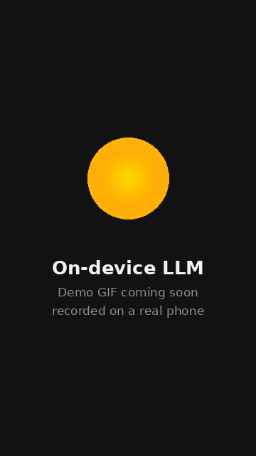

# On-device LLM: a private AI chat that runs entirely on your Android phone

[](https://github.com/ThalzeronLabs/android-on-device-llm/actions/workflows/ci.yml)
[](https://github.com/ThalzeronLabs/android-on-device-llm/releases/latest)
[](#requirements)
[](app/src/main/kotlin/com/thalzeronlabs/ondevicellm)
[](LICENSE)

**No server. No API key. No internet after the first download.** The model runs on the phone's CPU through
[llama.cpp](https://github.com/ggml-org/llama.cpp), wrapped by the Kotlin library
[llama-kotlin](https://github.com/ThalzeronLabs/llama-kotlin).

<p align="center">
  
</p>

> The demo GIF is being recorded on a real phone; until then `docs/demo.gif` is a placeholder.

## Try it in 1 minute

1. **Download the APK** from the [latest release](https://github.com/ThalzeronLabs/android-on-device-llm/releases/latest)
   (`on-device-llm-vX.Y.Z-arm64-v8a.apk`) on your phone.
2. **Open it** and allow "Install unknown apps" for your browser or file manager when Android asks.
3. **Open On-device LLM.** On Wi-Fi the model downloads by itself (on mobile data it asks first). When the bar
   finishes, turn on airplane mode and ask something: it still answers.

The release APK is a **demo build, not from Google Play**: it is signed with a throwaway key that the
[release workflow](.github/workflows/release.yml) generates for each build, and its SHA-256 is in the release notes.

## Requirements

| | |
|---|---|
| **Android** | 8.0 (API 26) or newer |
| **CPU** | 64-bit ARM (`arm64-v8a`), which is practically every phone from the last several years |
| **Storage** | about **1 GB free**: the model is 491 MB, plus room while it downloads |
| **RAM** | the 0.5B model is small; phones with more RAM can import bigger models |
| **Network** | only once, to download the model (~491 MB) |

## Privacy

**Nothing you type leaves the phone.** There is no server, account, analytics or crash reporter.
The app only uses the network to download the model file from
[Hugging Face](https://huggingface.co/Qwen/Qwen2.5-0.5B-Instruct-GGUF), and you can skip even that by picking a
`.gguf` file you already have. After that, every answer is generated on the device: try it in airplane mode.

## What it shows

- **On-device inference:** a 0.5B-parameter chat model (Qwen2.5-0.5B-Instruct, 4-bit `Q4_K_M`, 491 MB) answering
  in real time.
- **A download built for phones:** progress, **pause and resume** (HTTP `Range`, so a dropped connection or a killed
  app continues where it stopped), automatic retries with backoff, a free-space check, and a **SHA-256 check**
  against the published file (`74a4da8c…`) before the model is ever loaded. Or **bring your own `.gguf`** from the
  phone's storage (checked by its magic bytes).
- **Streaming UI in Jetpack Compose:** tokens appear as they are generated; **Stop** cancels mid-answer and keeps
  what was written; a live **tokens/s** chip shows the speed measured on your phone.
- **Clean architecture:** a `ViewModel` exposing one immutable `StateFlow<ChatUiState>`, with the model engine and
  the model source behind interfaces, so the screen logic and the downloader are unit-tested on the JVM, no
  device needed.

## Architecture

```
ChatScreen (Compose)  ◀── StateFlow<ChatUiState> ──  ChatViewModel
                                                        │
                         ┌──────────────────────────────┴───────────────┐
                         ▼                                              ▼
                ChatEngine (interface)                         ModelSource (interface)
                LlamaChatEngine ── llama-kotlin ── llama.cpp   HttpModelSource ── ModelDownloader
                                                               (resume · retry · SHA-256 · import)
```

## Built with llama-kotlin

All the native work (loading the GGUF, the chat template, sampling, streaming tokens) is done by
[**llama-kotlin**](https://github.com/ThalzeronLabs/llama-kotlin), a small coroutine-first Kotlin API over
llama.cpp, included here as a git submodule. The whole engine of this app is about 30 lines
([`ChatEngine.kt`](app/src/main/kotlin/com/thalzeronlabs/ondevicellm/data/ChatEngine.kt)):

```kotlin
val model = LlamaModel.load(file)                                  // on Dispatchers.IO
val session = model.newSession(SessionParams(contextSize = 4096, temperature = 0.7f))

session.chat(history, maxTokens = 1024)                            // Flow<String>, token by token
    .collect { piece -> appendToAnswer(piece) }                    // cancel the coroutine = Stop

session.lastStats?.tokensPerSecond                                 // the tok/s chip
```

Want to add on-device AI to your own app? Start from the library; this repository is the full example.

## Build it yourself

```bash
git clone --recursive https://github.com/ThalzeronLabs/android-on-device-llm
cd android-on-device-llm
./gradlew :app:assembleRelease
```

Needs JDK 17 and the Android SDK with NDK `28.2.13676358` and CMake `4.1.2` (Android Studio installs them).
A local release build without the demo-key variables is signed with your debug key.

## Tests

```bash
./gradlew :app:testDebugUnitTest
```

The downloader is tested against a fake server that drops connections, ignores `Range`, answers 5xx/404 and
serves corrupted bytes, plus one test over a real local HTTP socket.

## Contributing

Issues labelled [`good first issue`](https://github.com/ThalzeronLabs/android-on-device-llm/labels/good%20first%20issue)
are a good place to start. See [CONTRIBUTING.md](CONTRIBUTING.md) and the [changelog](CHANGELOG.md).

## License

Apache-2.0 © Esdras Souza (Thalzeron Labs). The model is downloaded from the official
[Qwen2.5-0.5B-Instruct-GGUF](https://huggingface.co/Qwen/Qwen2.5-0.5B-Instruct-GGUF) repository under its own license
(Apache-2.0).
