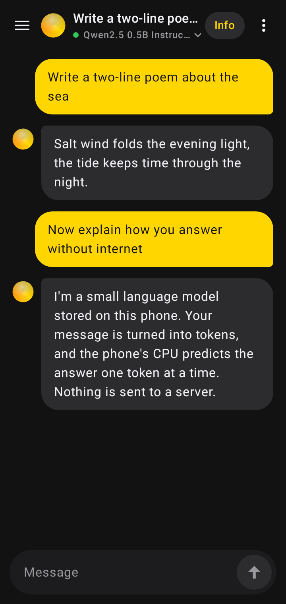
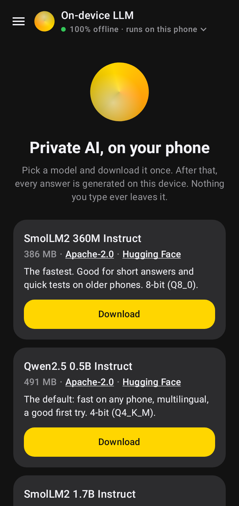
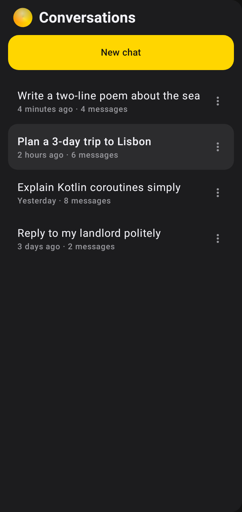
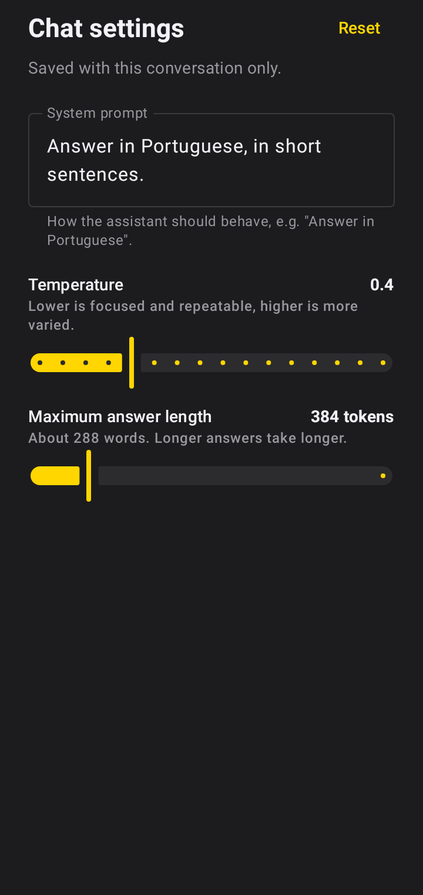
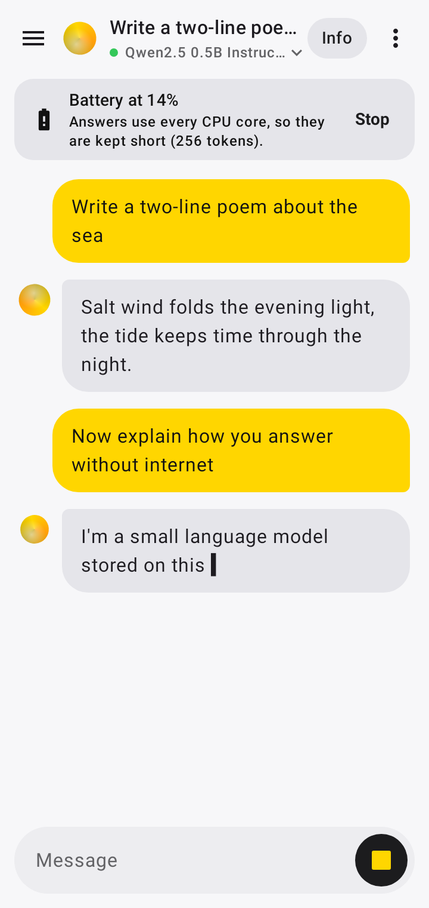
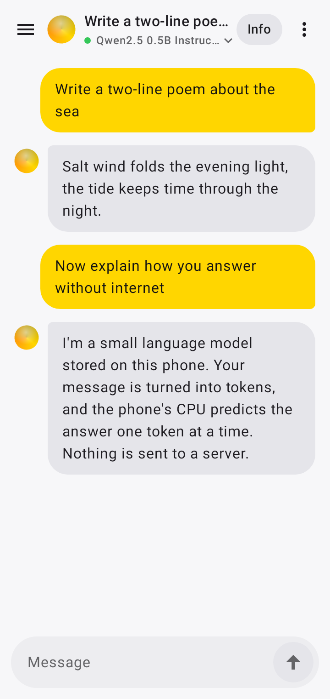
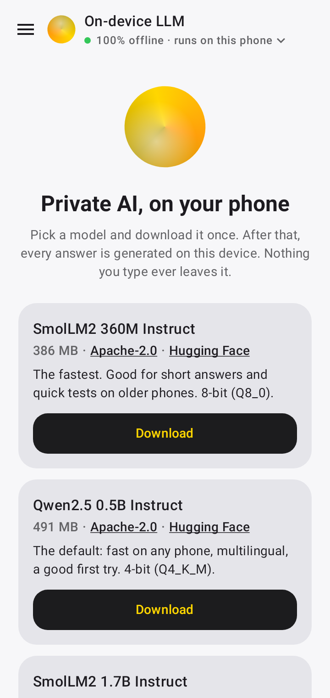
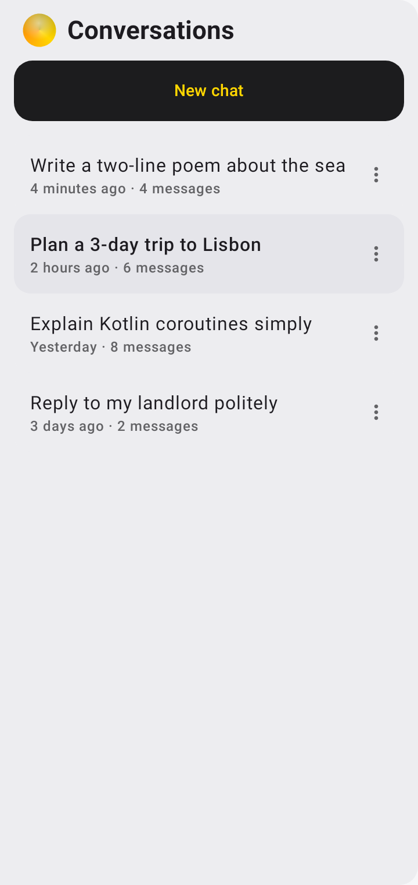
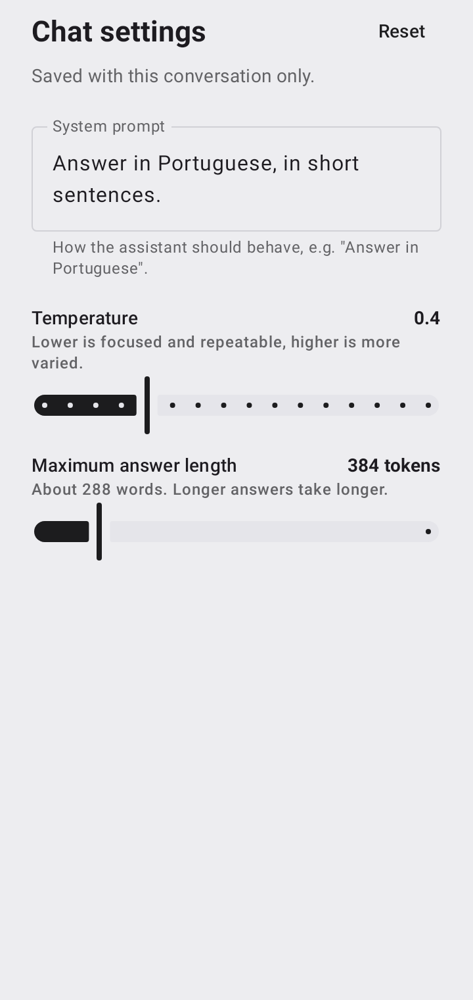

# On-device LLM: a private AI chat that runs entirely on your Android phone

[](https://github.com/ThalzeronLabs/android-on-device-llm/actions/workflows/ci.yml)
[](https://github.com/ThalzeronLabs/android-on-device-llm/releases/latest)
[](#requirements)
[](app/src/main/kotlin/com/thalzeronlabs/ondevicellm)
[](LICENSE)

**No server. No API key. No internet after the first download.** The model runs on the phone's CPU through
[llama.cpp](https://github.com/ggml-org/llama.cpp), wrapped by the Kotlin library
[llama-kotlin](https://github.com/ThalzeronLabs/llama-kotlin).

<p align="center">
  
</p>

> The demo GIF is being recorded on a real phone; until then `docs/demo.gif` is a placeholder.

### Screenshots

| Chat | Model catalog | Conversations | Chat settings | Battery saver |
|---|---|---|---|---|
|  |  |  |  |  |
|  |  |  |  | |

These are rendered from the real Compose screens by screenshot tests
([`ScreenshotTest.kt`](app/src/test/kotlin/com/thalzeronlabs/ondevicellm/ui/ScreenshotTest.kt), Roborazzi on
Robolectric), so they always match the code: CI fails when the UI changes without updating them.

## Try it in 1 minute

1. **Download the APK** from the [latest release](https://github.com/ThalzeronLabs/android-on-device-llm/releases/latest)
   (`on-device-llm-vX.Y.Z-arm64-v8a.apk`) on your phone.
2. **Open it** and allow "Install unknown apps" for your browser or file manager when Android asks.
3. **Open On-device LLM.** On Wi-Fi the default model (Qwen2.5 0.5B, 491 MB) downloads by itself; on mobile data
   you pick a model first. When the bar finishes, turn on airplane mode and ask something: it still answers.

The release APK is a **demo build, not from Google Play**. From v0.2.1 on it is signed with the Thalzeron Labs demo
key (used only for these showcase apps, never on Google Play), so new versions install over the previous one.
Certificate SHA-256:
`5D:9E:34:67:6F:72:29:18:00:CF:0D:AD:12:B7:66:A0:8A:2E:A4:8A:63:32:BD:ED:54:B9:E1:A4:27:A3:3C:D3`.
The APK's own SHA-256 is in each release's notes.

## Requirements

| | |
|---|---|
| **Android** | 8.0 (API 26) or newer |
| **CPU** | 64-bit ARM (`arm64-v8a`), which is practically every phone from the last several years |
| **Storage** | **386 MB to 1.1 GB per model** (see [Models](#models)), plus 50 MB of headroom while it downloads |
| **RAM** | the 0.5B models run on any recent phone; the 1.5B/1.7B models are best with 6 GB of RAM or more |
| **Network** | only to download a model, once |

## Privacy

**Nothing you type leaves the phone.** There is no server, account, analytics or crash reporter.
The app only uses the network to download a model file from its official Hugging Face page (see [Models](#models)),
and you can skip even that by picking a `.gguf` file you already have. Conversations are saved in a local database
that never leaves the phone (app backup is off). After that, every answer is generated on the device: try it in
airplane mode.

## What it shows

- **On-device inference:** small chat models (0.36B to 1.7B parameters, 4- or 8-bit GGUF) answering in real time
  on the phone's CPU.
- **Conversation history:** every chat is saved with **Room**; open the drawer to continue one, rename it or delete
  it. The first question becomes the title.
- **A model catalog, switchable at runtime:** four Apache-2.0 models, each with its size, license and official
  Hugging Face link. Download several, switch between them **without restarting the app**, delete the ones you no
  longer need, or import your own `.gguf`.
- **A download built for phones:** progress, **pause and resume** (HTTP `Range`, so a dropped connection or a killed
  app continues where it stopped), automatic retries with backoff, a free-space check, and a **SHA-256 check**
  against the published file before the model is ever loaded.
- **Per-conversation settings:** system prompt, temperature and maximum answer length, saved with each chat, with
  sensible defaults (0.7 and 512 tokens) and a reset button.
- **Share and copy:** share a conversation as **Markdown** or save it as a `.md` file; **long-press** any message to
  copy it.
- **Battery saver:** at 20% or less (or with Android's Battery Saver on) a banner warns that answers use every CPU
  core, offers **Stop** while an answer is being written and caps answers at 256 tokens. One tap turns it off.
- **Readable in light and dark:** the app follows the system theme, and every text color pair is unit-tested for
  WCAG AA contrast (4.5:1) in both.
- **Streaming UI in Jetpack Compose:** tokens appear as they are generated; **Stop** cancels mid-answer and keeps
  what was written; a live **tokens/s** chip shows the speed measured on your phone. Long conversations are trimmed
  to the newest turns that fit in the 4096-token context window.
- **Clean architecture, tested on the JVM:** a `ViewModel` exposing immutable `StateFlow`s, the engine, the model
  files and the conversations behind interfaces; ViewModel tests use **Turbine**, the database and Compose UI tests
  run under **Robolectric**. No device needed.

## Speed

On a POCO X6 Pro (Dimensity 8300), v0.2.4 writes about **35 tokens/s** with Qwen2.5 0.5B and about **15 tokens/s** with
Qwen2.5 1.5B (medians, measured on November 11, 2026). It finds the phone's fast CPU cores and keeps the model's threads
on them, with no setting to change. A side-by-side with two other on-device chat apps, with the method and its caveats,
is in the [v0.2.4 notes](CHANGELOG.md#024---2026-11-11), and every run is in
[docs/benchmarks](docs/benchmarks/2026-11-11-poco-x6-pro).

## Models

All four are instruction-tuned, **Apache-2.0**, published by their authors without a login wall, and pinned to the
exact size and SHA-256 that Hugging Face publishes for the file. A download that does not match is deleted.

| Model | File | Size | License | SHA-256 |
|---|---|---|---|---|
| [SmolLM2 360M Instruct](https://huggingface.co/HuggingFaceTB/SmolLM2-360M-Instruct-GGUF) | `smollm2-360m-instruct-q8_0.gguf` | 386 MB | [Apache-2.0](https://huggingface.co/HuggingFaceTB/SmolLM2-360M-Instruct) | `48ab3034…` |
| [Qwen2.5 0.5B Instruct](https://huggingface.co/Qwen/Qwen2.5-0.5B-Instruct-GGUF) (default) | `qwen2.5-0.5b-instruct-q4_k_m.gguf` | 491 MB | [Apache-2.0](https://huggingface.co/Qwen/Qwen2.5-0.5B-Instruct-GGUF/blob/main/LICENSE) | `74a4da8c…` |
| [SmolLM2 1.7B Instruct](https://huggingface.co/HuggingFaceTB/SmolLM2-1.7B-Instruct-GGUF) | `smollm2-1.7b-instruct-q4_k_m.gguf` | 1.06 GB | [Apache-2.0](https://huggingface.co/HuggingFaceTB/SmolLM2-1.7B-Instruct) | `decd2598…` |
| [Qwen2.5 1.5B Instruct](https://huggingface.co/Qwen/Qwen2.5-1.5B-Instruct-GGUF) | `qwen2.5-1.5b-instruct-q4_k_m.gguf` | 1.12 GB | [Apache-2.0](https://huggingface.co/Qwen/Qwen2.5-1.5B-Instruct-GGUF/blob/main/LICENSE) | `6a1a2eb6…` |

Full hashes are in [`ModelCatalog.kt`](app/src/main/kotlin/com/thalzeronlabs/ondevicellm/data/ModelCatalog.kt).
Llama 3.2 and Gemma 3 are not in the list: their official files require accepting a license on Hugging Face first,
so the app could not download them without an account. You can still import them as a `.gguf`.

## Architecture

```
ChatScreen (Compose)  ◀── StateFlow<ChatUiState>, StateFlow<ModelsState> ──  ChatViewModel
                                                                                │
        ┌───────────────────────────────┬───────────────────────────────────────┼────────────────────┐
        ▼                               ▼                                       ▼                    ▼
ConversationRepository          ModelManager (app-wide)                    ChatEngine           Flow<BatteryStatus>
RoomConversationRepository      catalog · download · switch · import      LlamaChatEngine      sticky broadcast +
 └─ Room: conversations,          └─ ModelStore ── ModelDownloader         └─ llama-kotlin      Battery Saver
    messages (per-chat settings)     (resume · retry · SHA-256)               └─ llama.cpp
```

## Built with llama-kotlin

All the native work (loading the GGUF, the chat template, sampling, streaming tokens) is done by
[**llama-kotlin**](https://github.com/ThalzeronLabs/llama-kotlin), a small coroutine-first Kotlin API over
llama.cpp, included here as a git submodule. The whole engine of this app is about 40 lines
([`ChatEngine.kt`](app/src/main/kotlin/com/thalzeronlabs/ondevicellm/data/ChatEngine.kt)):

```kotlin
val model = LlamaModel.load(file)                                  // on Dispatchers.IO; switching models = load another
val session = model.newSession(SessionParams(contextSize = 4096))

session.chat(history, maxTokens = settings.maxTokens,              // Flow<String>, token by token
    temperature = settings.temperature)                            // per answer: the KV cache is kept
    .collect { piece -> appendToAnswer(piece) }                    // cancel the coroutine = Stop

session.lastStats?.tokensPerSecond                                 // the tok/s chip
```

Want to add on-device AI to your own app? Start from the library; this repository is the full example.

## Build it yourself

```bash
git clone --recursive https://github.com/ThalzeronLabs/android-on-device-llm
cd android-on-device-llm
./gradlew :app:assembleRelease
```

Needs JDK 17 and the Android SDK with NDK `28.2.13676358` and CMake `4.1.2` (Android Studio installs them).
A local release build without the demo-key variables is signed with your debug key.

## Tests

```bash
./gradlew :app:testDebugUnitTest          # all unit tests
./gradlew :app:verifyRoborazziDebug       # the same, plus comparing the screens with docs/screenshots/
./gradlew :app:recordRoborazziDebug       # after an intended UI change: rewrite the screenshots
```

Everything runs on the JVM, no device needed:

| Area | What is tested |
|---|---|
| History | Room repository on an in-memory database (titles, order, counts, rename, per-chat settings, cascade delete); ViewModel flows with **Turbine** (save, continue, rename, delete, new chat) |
| Models | the catalog (official URLs, hashes, sizes, licenses), the model files (layout, import, delete, v0.1.0 migration), the manager (progress, pause, one download at a time, switching without restart, load errors) and the downloader (a fake server that drops connections, ignores `Range`, answers 5xx/404 and serves corrupted bytes, plus a real local HTTP socket) |
| Settings | defaults and clamping, the settings reaching the engine, the context window trimming |
| Share and copy | the Markdown export, the share intent, the clipboard, long-press to copy (Compose UI test) |
| Battery and themes | battery parsing and the low threshold, the 256-token cap, the banner and its Stop button (Compose UI test), WCAG contrast of both themes and the text color on every container |
| Screenshots | nine screens in light and dark, rendered on the JVM with Roborazzi and compared with `docs/screenshots/` in CI |

## How I build this

I use AI assistance (Claude) while I build this project: for drafting, exploring options and writing tests. I review every change myself, each one lands through a pull request with tests, and CI must pass before anything is merged. I'm responsible for every line.

## Contributing

Issues labelled [`good first issue`](https://github.com/ThalzeronLabs/android-on-device-llm/labels/good%20first%20issue)
are a good place to start. See [CONTRIBUTING.md](CONTRIBUTING.md) and the [changelog](CHANGELOG.md).

## License

Apache-2.0 © Esdras Souza (Thalzeron Labs). The models are downloaded from their authors' official Hugging Face
repositories under their own licenses (all Apache-2.0, see [Models](#models)).
